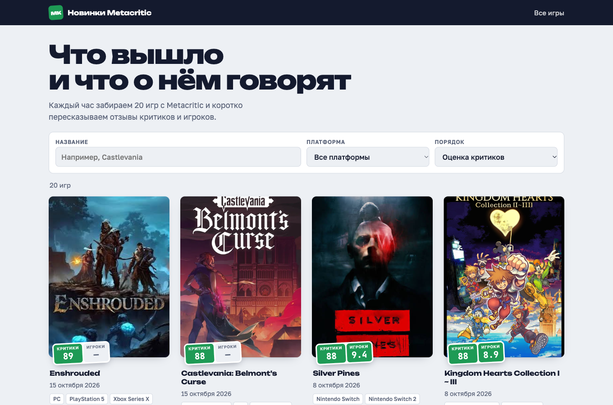
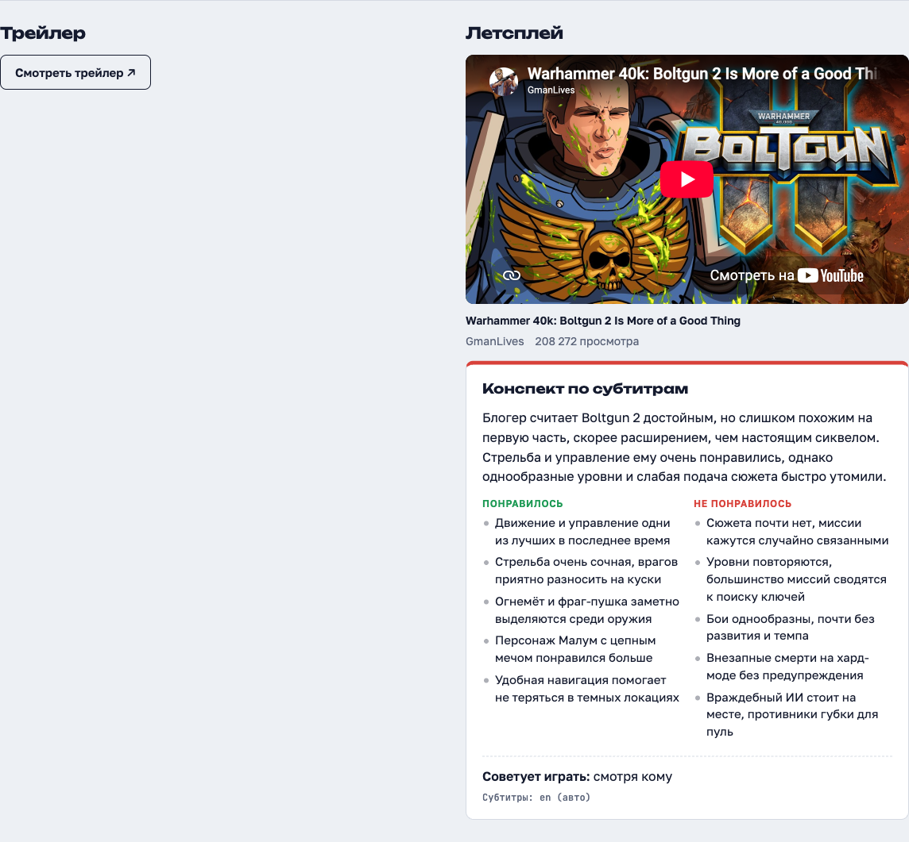
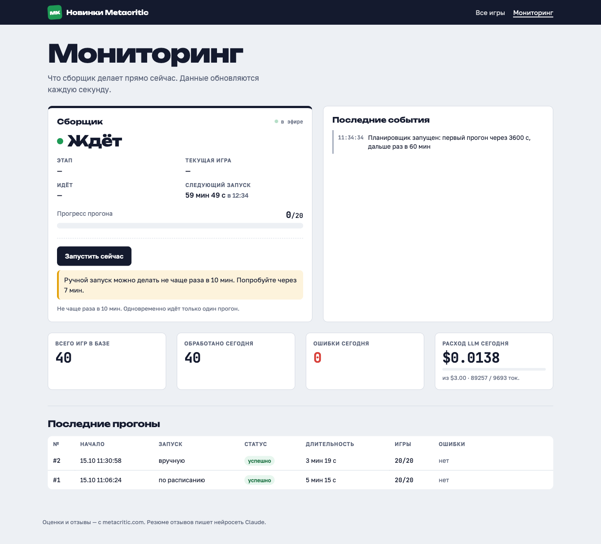

# Metacritic Games Tracker

Тестовое задание Скайтек. Сервис раз в час берёт 20 новых игр с Metacritic, делает краткое
резюме отзывов критиков и игроков на русском через Claude, подбирает похожие игры и находит
летсплей на YouTube с конспектом. Всё видно на сайте с поиском, фильтрами и живым мониторингом.

**Сервис:** https://188-130-141-107.sslip.io — логин `reviewer`, пароль в письме.

## Что умеет

- **Список игр:** обложка, оценки Metascore и User Score, платформы, жанр, дата выхода.
  Поиск по названию (в том числе по-русски), фильтр по платформе, сортировка.
- **Карточка игры:** резюме отзывов критиков и игроков (что хвалят, что ругают, итог),
  5 похожих игр, летсплей с YouTube и его конспект.
- **Мониторинг (доп. часть 2):** что сервис делает прямо сейчас (этап, текущая игра,
  лента событий), история прогонов, расход на LLM за сутки, кнопка «Запустить сейчас».
- **Летсплеи (доп. часть 1):** самый просматриваемый ролик с субтитрами из 10 найденных,
  конспект субтитров через Claude.

| Список | Карточка | Мониторинг |
|--------|----------|------------|
|  |  |  |

Мобильная версия: [список](docs/screenshots/home-mobile.png),
[карточка](docs/screenshots/game-letsplay-mobile.png).

## Архитектура

```
APScheduler (раз в час + кнопка, один прогон за раз)
   │
   ▼
Сборщик Metacritic ── backend.metacritic.com (внутренний JSON API сайта), HTML — запасной путь
   │  игра, оценки, до 30 отзывов критиков + до 30 игроков (поровну хороших и плохих)
   ▼
LLM: Claude Haiku 5.5 ── резюме отзывов (JSON по схеме), только если набор отзывов изменился
   ▼
Эмбеддинги bge-small (fastembed, ONNX) ── 5 похожих игр по косинусной близости
   ▼
Летсплей: yt-dlp ── поиск ролика, субтитры, конспект через Claude
   ▼
SQLite (WAL) ◄── Веб: FastAPI + Jinja2 + HTMX, мониторинг через SSE
```

Код: `app/scraper` (сборщик и отбор игр), `app/llm` (клиент Claude, бюджет, резюме),
`app/similar` (эмбеддинги), `app/letsplay` (YouTube), `app/worker` (планировщик и конвейер),
`app/web` (сайт и мониторинг).

## Как выбираются игры

- Раз в час сервис берёт 20 игр, которые **сегодня ещё не обрабатывались**. «Сегодня» — по московскому времени.
- Первый заход дня — блок New Releases на главной странице игр Metacritic.
- Дальше — список «все игры, новые сначала», по одной странице за заход.
- Игра считается обработанной, только когда прошла весь конвейер. Если упала (сеть, лимит API),
  следующий заход возьмёт её снова.
- Резюме отзывов пересчитывается, только если изменился хэш набора отзывов. Так повторный
  обход не тратит деньги.

## Модель и стоимость

- **Модель:** `claude-haiku-5-5` — самая дешёвая из актуальных Claude, для резюме отзывов её хватает.
  Ответ строго по JSON-схеме (structured outputs), поэтому разбор не ломается.
- **Цена:** $0.10 за 1 млн входных токенов, $0.50 за 1 млн выходных.
- **Одна игра:** резюме отзывов ≈ $0.0017 (2 вызова, ~12 тыс. токенов), конспект летсплея ≈ $0.001.
- **В сутки:** 24 захода × 20 игр. В худшем случае (у всех игр новые отзывы и летсплей) ≈ $1.3.
  На деле меньше: у новинок часто мало отзывов (тогда LLM не вызывается), а неизменные отзывы
  не пересчитываются.
- **Потолок:** `LLM_DAILY_BUDGET_USD=3`. Когда он исчерпан, сервис продолжает собирать игры,
  но резюме откладывает до завтра. Кнопку ручного запуска можно нажать не чаще раза в 10 минут.

Похожие игры считаются локально (эмбеддинги на процессоре), платы за них нет.

## Как запустить локально

Нужны Docker и ключ Claude API.

```bash
cp .env.example .env
```

В `.env` впиши `ANTHROPIC_API_KEY`. Без ключа сервис работает, но без резюме.

```bash
docker compose up --build
```

Сайт откроется на http://127.0.0.1:8000. Первый прогон начнётся через `FIRST_RUN_DELAY_SEC`
секунд после старта (по умолчанию 30). Для разработки удобно поставить `FIRST_RUN_DELAY_SEC=3600`:
тогда перезапуск контейнера не тратит деньги на LLM.

Без Docker:

```bash
uv sync
```

```bash
uv run uvicorn app.main:app --reload
```

Тесты и линтер:

```bash
uv run pytest -q
```

```bash
uv run ruff check . && uv run ruff format --check .
```

## Как развёрнуто

- Общий VPS, nginx + certbot, приложение на `127.0.0.1:8001` в Docker Compose.
- nginx отдаёт сайт по HTTPS (Let's Encrypt) и закрывает его паролем (Basic Auth).
- Обновление — `scripts/deploy.sh`: `git pull` и пересборка контейнера.

## Безопасность

Подробно — [docs/security.md](docs/security.md). Коротко:

- Ключ Claude только в `.env` на сервере. В git и в образ Docker он не попадает, перед коммитом работает gitleaks.
- Весь сайт за паролем. Кнопка запуска: только POST, проверка `Origin`, не чаще раза в 10 минут, один прогон за раз.
- Текст с Metacritic и YouTube считается недоверенным: в промте он внутри тегов `<reviews>` / `<transcript>`,
  у модели нет инструментов, ответ — только по JSON-схеме, на странице всё экранируется.
- Строгий CSP (запрет чужих скриптов), только параметризованные SQL-запросы.
- Сервер ходит только на Metacritic, YouTube и `api.anthropic.com`; ссылки из данных не запрашивает.
- 183 теста, покрытие 89%; bandit, pip-audit, trivy — без важных находок.

## Что сделано из дополнительных частей

- **Доп. часть 1 — летсплеи.** Для каждой игры ищется летсплей на YouTube (10 результатов поиска,
  берётся самый просматриваемый с субтитрами, в том числе автоматическими). По субтитрам Claude
  пишет конспект. Ролик встроен в карточку игры.
- **Доп. часть 2 — мониторинг.** Страница `/monitor`: текущий этап и игра, лента событий в реальном
  времени (SSE), история прогонов с ошибками, расход за сутки, кнопка ручного запуска.

## Известные ограничения

- **Неофициальный API Metacritic.** Сервис использует тот же JSON API, что и сайт metacritic.com.
  Его могут изменить без предупреждения. На этот случай есть запасной разбор HTML.
- **Блокировки YouTube.** YouTube может потребовать «подтвердить, что вы не бот». Тогда в карточке
  пишется «YouTube временно ограничил запросы», повтор — на следующий день. Если у роликов нет
  субтитров — тоже статус и повтор. Распознавание речи (Whisper) не используется.
- **Мало отзывов у новинок.** У только что вышедших игр отзывов часто нет — в карточке «Мало отзывов».
- **Старый процессор сервера.** На VPS нет инструкций SSE4, поэтому `numpy` закреплён ниже 2.3.

## Как работал с Claude Code

1. Сессия планирования: разбор ТЗ, выбор стека, план по шагам — [PLAN.md](PLAN.md),
   зафиксированные решения — [CLAUDE.md](CLAUDE.md).
2. Каждый шаг плана — отдельная сессия Claude Code с готовым промтом из PLAN.md.
   В конце шага — коммит, проверка, переход к следующему.
3. Список сессий — [docs/ai-chats.md](docs/ai-chats.md). Сами логи (JSONL) приложены к письму архивом
   `ai-chats.zip`. Скрипт выгрузки — [scripts/export_chats.py](scripts/export_chats.py): он скрывает
   секреты и проверяет результат gitleaks.
